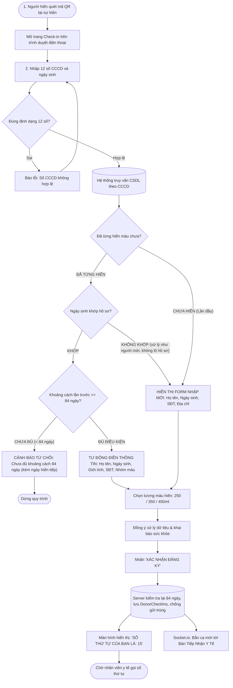
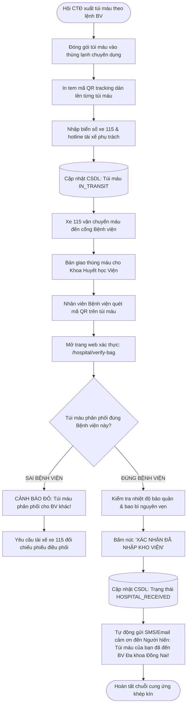

# ĐẶC TẢ NỘI DUNG DỰ ÁN & CHI TIẾT CÁC MODULE CHỨC NĂNG (PROJECT-CONTENT.MD)
## DỰ ÁN: SMARTBLOOD - HỆ THỐNG ĐIỀU PHỐI HIẾN MÁU NHÂN ĐẠO & CHUỖI CUNG ỨNG Y TẾ
### ĐƠN VỊ CHỦ QUẢN: HỘI CHỮ THẬP ĐỎ TP. BIÊN HÒA

---

## BƯỚC 1: ĐỊNH HÌNH Ý TƯỞNG & ĐÁNH GIÁ TÍNH KHẢ THI

### 1.1 Bối cảnh & Vấn đề thực tế
Tại TP. Biên Hòa (tỉnh Đồng Nai), các đợt hiến máu nhân đạo do Hội Chữ Thập Đỏ tổ chức tại các phường, xã, trường đại học và khu công nghiệp thường xuyên gặp các bất cập lớn:
1. **Rào cản công nghệ:** Người dân ngại tham gia vì bị yêu cầu cài đặt ứng dụng hoặc tạo tài khoản phức tạp trên điện thoại.
2. **Kê khai thủ công lặp lại:** Người hiến nhiều lần vẫn phải khai báo lại toàn bộ giấy tờ cá nhân viết tay, gây ùn tắc tại bàn tiếp nhận.
3. **Mất dấu vết túi máu & chậm trễ cấp cứu:** Thiếu kênh kết nối thời gian thực giữa kho máu của Hội Chữ Thập Đỏ với các bệnh viện lớn trên địa bàn (BV Đa khoa Đồng Nai, BV Đa khoa Thống Nhất), dẫn đến việc điều phối máu cấp cứu bị chậm trễ và người hiến không biết giọt máu của mình đã được chuyển đi đâu.
4. **Nguy cơ lộ lọt danh tính nhóm máu hiếm:** Danh sách người có nhóm máu hiếm ($Rh-, Bombay...$) lưu trữ thủ công dễ bị lộ thông tin hoặc bị làm phiền.

### 1.2 Giải pháp & Triết lý của SmartBlood
* **Hiến máu không cần đăng nhập:** Người dân chỉ cần quét mã QR tại sự kiện bằng camera điện thoại/Zalo để mở trang đăng ký.
* **Auto-fill CCCD thông minh:** Gõ 12 số CCCD kèm ngày sinh (CCCD không phải bí mật nên cần yếu tố xác minh thứ hai), hệ thống tự động điền lại thông tin cá nhân cũ và kiểm tra chu kỳ an toàn **84 ngày** theo **Thông tư 26/2013/TT-BYT**.
* **Chuỗi cung ứng khép kín (Closed-Loop Supply Chain):** Túi máu được chuyển đến bệnh viện có in mã QR. Nhân viên y tế bệnh viện quét mã QR để xác nhận đã nhận túi máu an toàn, lập tức đóng vòng lặp gửi tin nhắn cảm ơn cho người hiến.
* **Cổng điều phối cấp cứu hỏa tốc:** Bệnh viện có thể theo dõi kho máu Hội Chữ Thập Đỏ và phát lệnh báo động đỏ điều phối xe 115 khi kho viện cạn máu.
* **Két bảo mật Zero-Trust:** Mã hóa thông tin người hiến máu hiếm mức trường bằng AES-256-GCM.

---

## BƯỚC 2: MA TRẬN TÁC NHÂN (ACTOR) & PHÂN QUYỀN

Hệ thống phân định 5 nhóm tác nhân chính với trách nhiệm và quyền hạn độc lập:

| STT | Tác nhân (Actor) | Phân loại | Mô tả vai trò & Phạm vi quyền hạn |
| :---: | :--- | :--- | :--- |
| **1** | **Khách vãng lai / Người hiến (`GUEST_DONOR`)** | Primary | • Quét mã QR sự kiện để vào form đăng ký (không cần đăng nhập).<br>• Nhập số CCCD + ngày sinh để tự động điền thông tin cũ hoặc nhập mới.<br>• Đồng ý xử lý dữ liệu cá nhân và khai báo sức khỏe.<br>• Chọn lượng máu dự kiến (250/350/450ml; bác sĩ xác nhận khi khám).<br>• Nhận số thứ tự (STT) Check-in trên điện thoại. |
| **2** | **Người hiến có tài khoản (`REGISTERED_DONOR`)** | Primary | • Đăng ký / Đăng nhập tài khoản bằng số CCCD.<br>• Xem toàn bộ lịch sử các lần hiến máu thành công từ trước đến nay.<br>• Tải Giấy chứng nhận hiến máu điện tử (PDF kèm mã QR).<br>• Theo dõi thanh % phục hồi chu kỳ an toàn 84 ngày. |
| **3** | **Nhân viên y tế Hội CTĐ (`RED_CROSS_STAFF`)** | Primary | • Màn hình Bàn tiếp nhận theo dõi danh sách người hiến vừa quét QR.<br>• Xác nhận Bước 1: Tiếp nhận đối chiếu thông tin.<br>• Xác nhận Bước 2: Khám sàng lọc sinh hiệu (Huyết áp, Tim mạch, Cân nặng).<br>• Xác nhận Bước 3: Xét nghiệm nhanh mao mạch (Hemoglobin, Viêm gan B/C).<br>• Xác nhận Bước 4: Lấy máu, dán mã vạch và đưa túi vào kho cách ly (`QUARANTINE`) chờ xét nghiệm sàng lọc chính thức. |
| **4** | **Nhân viên y tế Bệnh viện (`HOSPITAL_STAFF`)** | Primary | • **Quét mã QR trên túi máu** để xác nhận đã tiếp nhận túi máu vào kho bệnh viện.<br>• Xem bảng tồn kho khả dụng của Hội Chữ Thập Đỏ (Read-only).<br>• **Phát lệnh cấp cứu khẩn cấp (`EMERGENCY_REQUEST`)** khi bệnh viện thiếu máu mổ hoặc cần nhóm máu hiếm. |
| **5** | **Quản trị Hội Chữ Thập Đỏ (`ADMIN`)** | Primary | • Tạo sự kiện hiến máu và sinh mã QR động của sự kiện.<br>• Quản trị kho máu toàn diện theo thuật toán FEFO.<br>• Điều phối xe cứu thương 115 chuyển máu đến các bệnh viện (nhập tay biển số, hotline tài xế).<br>• Yêu cầu mở Két bảo mật nhóm máu hiếm; việc phê duyệt do tài khoản `ADMIN` lãnh đạo khác (`laNguoiPheDuyet`) thực hiện.<br>• Quản lý tài khoản, mở khóa vi phạm Brute-force và xem Audit Logs. |

---

## BƯỚC 3: USER STORIES & TIÊU CHÍ NGHIỆM THU (ACCEPTANCE CRITERIA)

### US-01: Quét mã QR & Tra cứu CCCD Auto-fill (Không cần đăng nhập)
* **User Story:**
  > *As a* **Người hiến máu tại sự kiện (GUEST_DONOR)**,  
  > *I want to* quét mã QR tại điểm hiến và chỉ cần nhập số CCCD cùng ngày sinh của mình,  
  > *So that* hệ thống tự nạp lại toàn bộ thông tin cá nhân đã từng hiến trước đây, giúp tôi đăng ký trong vài giây mà không cần tạo tài khoản.
* **AC 01 · Happy Case (Đã từng hiến - Tự động nạp dữ liệu):**
  * **Given:** Người hiến mở camera quét mã QR của sự kiện trên Standee; trình duyệt mở trang check-in.
  * **When:** Người dùng nhập số CCCD `075203009988` (12 số) và ngày sinh trùng khớp hồ sơ; hệ thống kiểm tra lần hiến gần nhất $\ge 84$ ngày.
  * **Then:** Hệ thống tự động nạp sẵn: Họ tên, Ngày sinh, Giới tính, Địa chỉ, Số điện thoại, Nhóm máu. Người dùng chỉ cần chọn lượng máu (350ml hoặc 450ml) và nhấn *"Xác nhận đăng ký"*. Màn hình cấp số thứ tự: *"Số thứ tự tiếp nhận của bạn là: 12"*.
* **AC 02 · Error Case (Chưa đủ khoảng cách an toàn 84 ngày):**
  * **Given:** Người dùng đã từng hiến máu, nhưng lần hiến gần nhất mới cách 50 ngày trước.
  * **When:** Nhập CCCD vào ô tra cứu.
  * **Then:** Nút xác nhận bị khóa, hiển thị cảnh báo đỏ nổi bật: *"Bạn chưa đủ khoảng cách an toàn 84 ngày theo Thông tư 26/BYT. Lần hiến gần nhất: 15/09/2026. Ngày sớm nhất bạn có thể hiến tiếp: 08/12/2026"*. Nếu client bỏ qua giao diện và gọi thẳng `submit`, server vẫn từ chối.
* **AC 03 · Error Case (Sai ngày sinh):**
  * **Given:** Một người nhập CCCD của người khác nhưng ngày sinh không khớp.
  * **When:** Gửi tra cứu.
  * **Then:** Hệ thống không điền dữ liệu nào và phản hồi giống người hiến mới (không tiết lộ CCCD đã có hồ sơ); sau 5 lần sai trong 1 giờ trên cùng CCCD thì từ chối tra cứu. Nếu vẫn đăng ký, server trả lỗi `409` yêu cầu đối chiếu tại bàn tiếp nhận và không ghi đè hồ sơ cũ.

---

### US-02: Nhân viên y tế Bệnh viện quét mã QR xác nhận tiếp nhận túi máu
* **User Story:**
  > *As an* **Nhân viên y tế Bệnh viện (HOSPITAL_STAFF)**,  
  > *I want to* quét mã QR in trên nhãn túi máu khi xe 115 giao đến khoa Huyết học,  
  > *So that* tôi xác nhận đã nhận máu vào kho bệnh viện an toàn và đóng vòng lặp thông báo cho người hiến.
* **AC 01 · Happy Case (Xác nhận nhập kho viện thành công):**
  * **Given:** Nhân viên BV Đa khoa Đồng Nai đăng nhập tài khoản bệnh viện; xe cứu thương vừa giao thùng máu.
  * **When:** Nhân viên quét mã QR trên túi máu $\rightarrow$ Trang web mở chi tiết túi máu `BAG-2026-000089` $\rightarrow$ Nhấn *"Xác nhận nhập kho Bệnh viện"*.
  * **Then:** Túi máu chuyển trạng thái sang `HOSPITAL_RECEIVED`. Hệ thống tự động gửi tin nhắn cảm ơn đến người hiến: *"Túi máu của bạn vừa được BV Đa khoa Đồng Nai tiếp nhận an toàn để phục vụ người bệnh!"*.
* **AC 02 · Error Case (Giao nhầm bệnh viện):**
  * **Given:** Túi máu có bệnh viện đích là BV Thống Nhất nhưng nhân viên BV Đa khoa Đồng Nai quét nhận.
  * **When:** Nhấn xác nhận nhận máu. (Bệnh viện của người nhận lấy từ tài khoản đăng nhập; sửa request cũng không đổi được.)
  * **Then:** Hệ thống chặn lại với thông báo lỗi: *"Cảnh báo: Túi máu này được điều phối cho BV Thống Nhất. Vui lòng kiểm tra lại với tài xế xe 115"*.

---

### US-03: Bệnh viện phát lệnh cấp cứu máu hỏa tốc (Báo động đỏ)
* **User Story:**
  > *As a* **Bác sĩ trực cấp cứu Bệnh viện (HOSPITAL_STAFF)**,  
  > *I want to* gửi lệnh cấp cứu máu nguy cấp qua hệ thống đến Hội Chữ Thập Đỏ,  
  > *So that* Hội Chữ Thập Đỏ lập tức điều phối xe 115 chuyển máu hoặc huy động người hiến máu hiếm khẩn cấp.
* **AC 01 · Happy Case:**
  * **Given:** Bệnh viện có ca cấp cứu mất máu cấp, cần gấp 2 đơn vị máu $O\ Rh(-)$.
  * **When:** Bác sĩ chọn mức độ *"NGUY CẤP (Báo động đỏ)"*, chọn nhóm máu $O\ Rh(-)$, số lượng `2`, nhập mã bệnh án $\rightarrow$ Nhấn *"PHÁT LỆNH CẤP CỨU"*.
  * **Then:** Hệ thống gửi lệnh trong 1 giây; kích hoạt còi hú âm thanh (sau khi màn hình trực đã bật âm thanh đầu ca) và popup nhấp nháy đỏ trên màn hình điều phối của Hội Chữ Thập Đỏ qua Socket.io. Nhân viên bấm "Đã nhận lệnh"; nếu quá 2 phút chưa ai xác nhận thì gửi thêm SMS/email cho người trực.

---

## BƯỚC 4: THIẾT KẾ SƠ ĐỒ LUỒNG (USER FLOW)

### 4.1 Luồng Quét QR Check-in & Auto-fill CCCD (Mobile Donor)



---

### 4.2 Luồng Xuất kho máu về Bệnh viện & Quét mã QR xác nhận tiếp nhận



---

## BƯỚC 5: ĐẶC TẢ CHI TIẾT TỪNG MODULE CHỨC NĂNG CỦA DỰ ÁN

Hệ thống được chia thành **6 Module chức năng độc lập** theo kiến trúc I-P-O (Input - Processing - Output):

```
┌────────────────────────────────────────────────────────────────────────────────┐
│                    TỔNG HỢP 6 MODULE CHỨC NĂNG SMART-BLOOD                    │
├───────────────────────┬───────────────────────┬────────────────────────────────┤
│       MODULE 1        │       MODULE 2        │           MODULE 3             │
│   EVENT & QR CODE     │    PUBLIC CHECK-IN    │       MEDICAL WORKFLOW         │
│  (Sự kiện & Mã QR)    │ (Check-in không login)│ (Tiến trình lấy máu y tế)      │
├───────────────────────┼───────────────────────┼────────────────────────────────┤
│       MODULE 4        │       MODULE 5        │           MODULE 6             │
│   INVENTORY & VAULT   │  HOSPITAL INTEGRATION │     DONOR PORTAL & HISTORY     │
│ (Kho FEFO & Máu hiếm) │ (Quét QR viện & 115)  │  (Cổng cá nhân & Xem lịch sử)  │
└───────────────────────┴───────────────────────┴────────────────────────────────┘
```

---

### MODULE 1: QUẢN LÝ SỰ KIỆN HIẾN MÁU & MÃ QR ĐỘNG (`EventQRModule`)

* **Actor sử dụng:** Quản trị viên Hội Chữ Thập Đỏ (`ADMIN`), Nhân viên Hội Chữ Thập Đỏ (`RED_CROSS_STAFF`).
* **Mục tiêu:** Tạo và quản lý các đợt hiến máu lưu động tại các địa phương, tự động sinh mã QR phục vụ in ấn Standee/Poster.

#### **Chức năng 1.1: Tạo sự kiện hiến máu mới**
* **Input:** `tenSuKien`, `diaDiem`, `diaChiChiTiet`, `ngayToChuc`, `gioBatDau`, `gioKetThuc`, `chiTieuSoLuong` (số túi máu dự kiến), `ghiChu`.
* **Processing:**
  1. Kiểm tra ngày tổ chức không được ở quá khứ.
  2. Băm tạo mã sự kiện duy nhất (ví dụ: `SK-BH-202611-01`).
  3. Tạo bản ghi mới trong bảng `DonationEvents` với `trangThai = 'UPCOMING'`.
  4. Tự động kích hoạt Chức năng 1.2 để sinh mã QR của sự kiện.
* **Output:** `HTTP 201 Created` kèm payload chi tiết sự kiện và URL ảnh QR Code.

#### **Chức năng 1.2: Sinh mã QR động cho sự kiện**
* **Input:** `eventId` (UUID).
* **Processing:**
  1. Xây dựng đường dẫn Web Check-in: `https://smartblood.vn/checkin?eventId={eventId}`.
  2. Sử dụng thư viện `qrcode` sinh ảnh vector SVG độ nét cao (chuẩn in khổ lớn Standee $80\times 180\text{ cm}$) và file ảnh PNG.
  3. Lưu file ảnh vào bộ nhớ tĩnh hoặc Object Storage.
* **Output:** File ảnh QR Code và liên kết tải xuống định dạng PDF Poster in ấn.

#### **Chức năng 1.3: Giám sát tiến độ tiếp nhận sự kiện theo thời gian thực**
* **Input:** `eventId`.
* **Processing:**
  1. Đếm số lượng người đã quét QR Check-in (`soLuongDangKy`).
  2. Đếm số lượng người đã hoàn tất lấy máu (`soLuongThanhCong`).
  3. Tính tỷ lệ % hoàn thành chỉ tiêu: $\text{Progress} = \frac{\text{soLuongThanhCong}}{\text{chiTieuSoLuong}} \times 100\%$.
  4. Lắng nghe WebSocket để cập nhật thanh tiến độ trực tiếp.
* **Output:** `HTTP 200 OK` kèm Dashboard chỉ số tiến độ sự kiện.

---

### MODULE 2: CỔNG TIẾP NHẬN CÔNG KHAI KHÔNG CẦN ĐĂNG NHẬP (`PublicCheckInModule`)

* **Actor sử dụng:** Người hiến máu tại sự kiện, Khách vãng lai (`GUEST_DONOR`).
* **Mục tiêu:** Giúp người dân làm thủ tục hiến máu siêu tốc trên điện thoại di động mà không cần cài app hay đăng ký tài khoản.

#### **Chức năng 2.1: Tra cứu CCCD thông minh & Tự động điền (Auto-fill)**
* **Input:** `cccd` (chuỗi 12 ký tự số), `ngaySinh`. Gửi bằng `POST` (body), không đưa CCCD vào URL để tránh bị ghi vào log.
* **Processing:**
  1. Validate định dạng CCCD bằng Regex (`^[0-9]{12}$`) và ngày sinh hợp lệ.
  2. Kiểm tra giới hạn: tối đa 5 lần sai ngày sinh mỗi giờ cho mỗi CCCD (đếm trong bộ nhớ ứng dụng), cộng giới hạn theo IP.
  3. Truy vấn bảng `Donors` theo **cả CCCD và ngày sinh**:
     * **Không có hồ sơ khớp** (chưa từng hiến, hoặc có CCCD nhưng ngày sinh không khớp): Trả về `isNewDonor: true`. Hai trường hợp được trả giống hệt nhau để không tiết lộ việc một CCCD đã có hồ sơ.
     * **Có hồ sơ khớp:** Lấy ngày hiến gần nhất từ `DonationHistory` (`MAX(ngayHien)`).
       - Tính $\Delta t = \text{Hôm nay (giờ Việt Nam)} - \text{ngày hiến gần nhất}$.
       - Nếu $\Delta t < 84$ ngày: Trả về `eligible: false`, lý do vi phạm Thông tư 26/BYT kèm ngày sớm nhất được hiến tiếp.
       - Nếu $\Delta t \ge 84$ ngày: Trả về `eligible: true`, `isNewDonor: false`, dữ liệu cũ `{ hoTen, ngaySinh, gioiTinh, soDienThoai, diaChi, nhomMau, rhFactor }`. Với người hiến máu hiếm, `soDienThoai` và `diaChi` không được trả về (người hiến nhập lại).
* **Output:** `HTTP 200 OK` kèm JSON kết quả tra cứu; `429` khi vượt giới hạn.

#### **Chức năng 2.2: Đăng ký hiến máu tại sự kiện & Cấp số thứ tự (STT)**
* **Input:** `clientRequestId` (UUID do client sinh một lần cho mỗi form), `eventId`, `cccd`, `hoTen`, `soDienThoai`, `ngaySinh`, `gioiTinh`, `diaChi`, `luongMauDangKy` (250 | 350 | 450ml, dự kiến), `daDongYXuLyDuLieu`, `khaiBaoSucKhoe`.
* **Processing:**
  1. Gọi Stored Procedure `sp_SubmitDonorCheckIn` có Transaction:
     - Nếu `clientRequestId` đã tồn tại: trả lại kết quả cũ (không tạo thêm lượt, không cấp thêm STT).
     - Kiểm tra sự kiện đang mở đúng khung giờ; từ chối nếu chưa tới hoặc đã kết thúc.
     - **Kiểm tra lại 84 ngày ở server** (không dựa vào giao diện).
     - Người mới: tạo hồ sơ `Donors`. Người đã có hồ sơ: yêu cầu ngày sinh khớp, nếu không trả `409` (đối chiếu tại bàn tiếp nhận). **Không ghi đè** họ tên, ngày sinh, nhóm máu; chỉ cập nhật SĐT và địa chỉ (người hiến máu hiếm: dữ liệu liên hệ đi vào `RareBloodVault` đã mã hóa).
     - Cấp STT bằng bộ đếm một dòng của sự kiện (không dùng `MAX(stt)+1` rồi khóa cả bảng).
     - Tạo bản ghi mới trong `DonorCheckIns` với `buocHienTai = 'CHO_KHAM'`.
  2. Kích hoạt Socket.io `donor:checkin_submitted` vào kênh `/staff` (cần JWT nhân viên) và cập nhật `/display` (chỉ STT).
* **Output:** `HTTP 201 Created` kèm `{ stt: 15, checkInId, thoiGianCheckIn, trackingToken }` (không trả lại dữ liệu cá nhân).

---

### MODULE 3: ĐIỀU PHỐI TIẾN TRÌNH Y TẾ HỘI CHỮ THẬP ĐỎ (`MedicalWorkflowModule`)

* **Actor sử dụng:** Nhân viên y tế Hội Chữ Thập Đỏ (`RED_CROSS_STAFF`).
* **Mục tiêu:** Màn hình Bàn tiếp nhận điều phối luồng người hiến qua 4 bước chuẩn y tế, chống ùn tắc và bảo đảm an toàn truyền máu.

#### **Chức năng 3.1: Hàng đợi Bàn tiếp nhận thời gian thực (Queue Tracker)**
* **Input:** `eventId`.
* **Processing:** Lấy danh sách người hiến đang tham gia sự kiện theo thứ tự STT, phân thành 4 cột Kanban theo `buocHienTai`:
  * Cột 1: *Chờ tiếp nhận & khám lâm sàng* (`CHO_KHAM`)
  * Cột 2: *Chờ xét nghiệm nhanh* (`CHO_XET_NGHIEM`)
  * Cột 3: *Chờ lấy máu* (`CHO_LAY_MAU`)
  * Cột 4: *Hoàn tất / Tạm hoãn* (`HOAN_THANH`, `TAM_HOAN`)
  * Lý do tạm hoãn và kết quả xét nghiệm chỉ hiển thị cho nhân viên có quyền. TV công cộng chỉ hiển thị STT và bước.
* **Output:** Bảng dữ liệu DataTable có lọc theo STT, Họ tên, tìm kiếm Debounce và tự nhảy trạng thái qua Socket.io.

#### **Chức năng 3.2: Khám sàng lọc lâm sàng & Đo sinh hiệu (Bước 1)**
* **Input:** `checkInId`, `huyetApTamThu`, `huyetApTamTruong`, `nhipTim`, `canNang`, `theTichDuocPhep` (ml), `ketLuan` (`DAT` | `TAM_HOAN`), `lyDo`.
* **Processing:**
  1. So sinh hiệu với **bảng ngưỡng cấu hình** (giá trị tạm, bộ phận y tế phải xác nhận theo Thông tư trước khi dùng thật): cân nặng $\ge 45\text{ kg}$, huyết áp tâm thu $100 - 140\text{ mmHg}$, tâm trương $60 - 90\text{ mmHg}$, nhịp tim $60 - 90\text{ lần/phút}$. Ngưỡng có thể khác nhau theo giới và theo thể tích lấy. Thể tích được phép lấy do bác sĩ xác nhận ở bước này.
  2. Lưu bản ghi vào bảng `ClinicalExams`.
  3. Nếu `DAT`: Cập nhật `DonorCheckIns.buocHienTai = 'CHO_XET_NGHIEM'`.
  4. Nếu `TAM_HOAN`: Cập nhật `DonorCheckIns.buocHienTai = 'TAM_HOAN'`, lưu lý do tạm hoãn để in phiếu tư vấn sức khỏe cho người hiến.
* **Output:** `HTTP 200 OK` kèm trạng thái mới.

#### **Chức năng 3.3: Xét nghiệm nhanh mao mạch (Bước 2)**
* **Input:** `checkInId`, `hemoglobin` (g/dL), `testHbsAg` (Viêm gan B: Âm/Dương), `testHCV` (Viêm gan C), `testHIV`, `nhomMauXacNhan`, `rhFactor`.
* **Processing:**
  1. Kiểm tra: Hemoglobin đạt ngưỡng cấu hình (giá trị tạm $\ge 12.0\text{ g/dL}$) và 100% test nhanh virus Âm tính.
  2. Lưu bản ghi vào `ScreeningTests`. Ghi nhóm máu sơ bộ vào hồ sơ `Donors`. Nếu nhóm máu thuộc danh mục hiếm: đặt `laNhomMauHiem = 1`, chuyển SĐT/địa chỉ vào `RareBloodVault` (mã hóa AES-256-GCM) và để `NULL` ở `Donors`.
  3. Nếu đạt: Cập nhật `DonorCheckIns.buocHienTai = 'CHO_LAY_MAU'`.
  4. Nếu **không đạt** (Hb thấp hoặc test dương tính): Cập nhật `buocHienTai = 'TAM_HOAN'`, lưu lý do. Kết quả dương tính chỉ báo riêng cho nhân viên có quyền để tư vấn; không hiển thị trên TV hay điện thoại người hiến và không gửi qua Socket công khai.
  5. Nhóm máu chính thức được xác nhận ở bước xét nghiệm sàng lọc chính thức (Chức năng 4.3).
* **Output:** `HTTP 200 OK`.

#### **Chức năng 3.4: Lấy máu, sinh mã túi máu & Nhập kho cách ly (Bước 3 & 4)**
* **Input:** `checkInId`, `theTichThucTe` (ml), `viTriKhoLanhTamThoi`.
* **Processing:**
  1. Sinh mã túi máu nội bộ `BAG-<năm>-<số seri 6 chữ số>` từ SQL `SEQUENCE` (duy nhất qua mọi sự kiện và mọi ngày). Đây không phải mã ISBT-128 chính thức; việc ánh xạ sang ISBT-128 (cần mã cơ sở được cấp) để giai đoạn sau nếu bệnh viện yêu cầu.
  2. Sinh mã QR dán trên nhãn túi máu, chỉ chứa mã túi (không chứa dữ liệu cá nhân) phục vụ Bệnh viện quét nhận.
  3. Thực thi Stored Procedure có Transaction:
     * Tạo bản ghi trong `BloodBags` với `trangThai = 'QUARANTINE'`, `ngayHetHan = ngayLay + 35 ngày` (giả định túi hồng cầu; thành phần khác do bộ phận y tế xác nhận).
     * Tạo bản ghi lịch sử hiến trong `DonationHistory`.
     * Cập nhật `DonorCheckIns.buocHienTai = 'HOAN_THANH'`.
  4. Túi máu `QUARANTINE` **không** tính vào tồn kho khả dụng và không được xuất kho cho đến khi qua Chức năng 4.3.
* **Output:** `HTTP 201 Created` kèm mã túi máu in nhãn tem và mã QR.

---

### MODULE 4: QUẢN LÝ KHO MÁU FEFO & KÉT BẢO MẬT NHÓM MÁU HIẾM (`InventoryVaultModule`)

* **Actor sử dụng:** Quản trị viên Hội Chữ Thập Đỏ (`ADMIN`).
* **Mục tiêu:** Quản trị kho lạnh bảo quản máu theo hạn dùng FEFO và bảo vệ thông tin người hiến máu hiếm theo chuẩn Zero-Trust.

#### **Chức năng 4.1: Quản lý kho máu theo thuật toán FEFO (First Expired, First Out)**
* **Input:** Tiêu chí lọc (Nhóm máu, Hạn sử dụng, Kho bảo quản).
* **Processing:**
  1. Truy vấn bảng `BloodBags` có `trangThai = 'IN_STOCK'` sắp xếp theo `ORDER BY ngayHetHan ASC`. Tồn kho tổng hợp lấy từ view `vw_BloodInventorySummary`, không có bảng `KhoMau` riêng.
  2. Phân loại theo màu sắc cảnh báo:
     * Đỏ: Hạn dùng còn $< 7$ ngày.
     * Vàng: Hạn dùng còn $7 - 15$ ngày.
     * Xanh: Hạn dùng $> 15$ ngày.
* **Output:** Bảng dữ liệu chuẩn DataTable (Tất cả/50/20/10, Sắp xếp hạn dùng, Bộ lọc nhóm máu).

#### **Chức năng 4.2: Két bảo mật Nhóm Máu Hiếm (Zero-Trust Rare Blood Vault)**
* **Input:** `donorId`, `nhomMauHiem` ($Rh-, Bombay...$), `maBenhAnCapCuu`; phía người phê duyệt: `otp` do hệ thống gửi cho chính người này.
* **Processing:**
  1. Khi người hiến có nhóm máu hiếm: Số điện thoại và Địa chỉ được mã hóa **AES-256-GCM** (mỗi trường một IV và authTag riêng, kèm `keyVersion`) rồi lưu vào `RareBloodVault`; hai trường này ở bảng `Donors` để `NULL`. Khóa nạp từ secret store, không nằm trong mã nguồn hay CSDL.
  2. Khi có ca cấp cứu khẩn từ Bệnh viện: Admin (người yêu cầu) gửi yêu cầu kèm mã bệnh án $\rightarrow$ Hệ thống thông báo và gửi OTP cho một tài khoản `ADMIN` lãnh đạo **khác** (`laNguoiPheDuyet = 1`) $\rightarrow$ Người phê duyệt tự nhập OTP trong phiên đăng nhập của mình (TTL 5 phút, tối đa 3 lần). OTP không chuyển cho người yêu cầu.
  3. Duyệt thành công: quyền xem có hiệu lực **15 phút** ở phía máy chủ; mỗi lần xem máy chủ giải mã theo yêu cầu, hết hạn trả `403`. Giao diện ẩn số khi hết đồng hồ.
  4. Ghi vĩnh viễn vào `AuditLogs` mọi bước: yêu cầu, duyệt, từ chối, xem (ai, lúc nào, mã bệnh án nào).
* **Output:** Số điện thoại người hiến máu hiếm để nhân viên gọi điện thoại vận động khẩn cấp.

#### **Chức năng 4.3: Duyệt túi máu cách ly sau xét nghiệm sàng lọc chính thức**
* **Input:** `bloodBagId`, `ketQuaSangLoc` (`DAT` | `KHONG_DAT`), nhóm máu xác nhận chính thức.
* **Processing:** Gọi `sp_RecordBloodBagLabResult` trong Transaction: `DAT` $\rightarrow$ `trangThai = 'IN_STOCK'`; `KHONG_DAT` $\rightarrow$ `DISCARDED`. Ghi `AuditLogs`, phát `inventory:stock_changed`.
* **Output:** `HTTP 200 OK`. Quy trình thực tế (ai thực hiện xét nghiệm sàng lọc, ở đâu) cần Hội CTĐ và đơn vị y tế xác nhận, xem `Overview.md` mục 6.

---

### MODULE 5: PHÂN PHỐI BỆNH VIỆN & CẤP CỨU KHẨN 115 (`HospitalIntegrationModule`)

* **Actor sử dụng:** Nhân viên y tế Bệnh viện (`HOSPITAL_STAFF`), Quản trị Hội CTĐ (`ADMIN`).
* **Mục tiêu:** Kết nối Bệnh viện với Hội Chữ Thập Đỏ; quét mã QR nhận túi máu và điều phối cấp cứu khẩn cấp.

#### **Chức năng 5.1: Cổng Bệnh viện xem tồn kho máu Hội Chữ Thập Đỏ (Read-only)**
* **Input:** Token xác thực có vai trò `HOSPITAL_STAFF`.
* **Processing:** Truy vấn tổng hợp số lượng túi và thể tích khả dụng trong kho của Hội Chữ Thập Đỏ theo 8 nhóm máu (`A+, A-, B+, B-, O+, O-, AB+, AB-`).
* **Output:** `HTTP 200 OK` kèm giao diện thẻ chỉ số trực quan.

#### **Chức năng 5.2: Bệnh viện phát lệnh cấp cứu máu hỏa tốc**
* **Input:** `bloodType`, `rhFactor`, `unitsNeeded`, `urgencyLevel` (`NGUY_CAP` | `RAT_KHAN`), `patientCaseId`. Bệnh viện lấy từ tài khoản đăng nhập.
* **Processing:**
  1. Tạo bản ghi yêu cầu trong bảng `EmergencyRequests`.
  2. Socket.io phát `emergency:red_alert` kích hoạt còi hú trên màn hình Hội Chữ Thập Đỏ. Nhân viên trực bấm "Đã nhận lệnh" (`thoiGianXacNhan`); nếu quá 2 phút chưa xác nhận thì gửi thêm SMS/email cho người trực.
  3. Thuật toán gợi ý các túi `IN_STOCK` cận hạn nhất, tương thích với nhóm máu yêu cầu.
  4. Xuất kho qua `POST /api/v1/hospital/dispatch` (`sp_DispatchBloodBagsFEFO`), nhập tay biển số xe và hotline tài xế 115.
* **Output:** `HTTP 201 Created` kèm mã lệnh cấp cứu.

#### **Chức năng 5.3: Bệnh viện quét mã QR trên túi máu xác nhận tiếp nhận an toàn**
* **Input:** `bagCode` (quét từ mã QR trên túi máu), `temperatureRecorded`. Người nhận và bệnh viện của họ lấy từ tài khoản đăng nhập (`Users.hospitalId`), **không nhận `hospitalId` từ client**.
* **Processing:**
  1. Kiểm tra túi máu trong bảng `BloodBags` (phải đang `IN_TRANSIT`).
  2. Xác minh `BloodBags.destinationHospitalId == Users.hospitalId` của người đăng nhập. Nếu sai $\rightarrow$ Trả về mã lỗi `400 Bad Request: Giao sai bệnh viện đích`.
  3. Thực hiện Stored Procedure cập nhật trạng thái túi máu sang `HOSPITAL_RECEIVED`, ghi nhận thời gian nhận, người nhận và nhiệt độ vào `HospitalDispatchBags`; khi mọi túi của lệnh đã nhận thì `HospitalDispatches.trangThaiGiao = 'DELIVERED'`.
  4. **Kích hoạt đóng vòng lặp cung ứng:** Tự động gửi tin nhắn/email cho Người hiến máu báo tin túi máu đã đến Bệnh viện an toàn để cứu chữa bệnh nhân.
* **Output:** `HTTP 200 OK` kèm thông báo xác nhận thành công.

---

### MODULE 6: CỔNG THÔNG TIN NGƯỜI HIẾN & LỊCH SỬ CÁ NHÂN (`DonorPortalModule`)

* **Actor sử dụng:** Người hiến máu có tài khoản (`REGISTERED_DONOR`).
* **Mục tiêu:** Tra cứu lịch sử hiến máu cá nhân, tải Giấy chứng nhận điện tử và quản lý tài khoản an toàn.

#### **Chức năng 6.1: Đăng ký / Đăng nhập tài khoản liên kết CCCD**
* **Input:** `cccd`, `ngaySinh`, `email`, `matKhau`.
* **Processing:**
  1. Kiểm tra hồ sơ trong bảng `Donors`: CCCD và ngày sinh phải khớp. Tạo tài khoản ở trạng thái `PENDING_VERIFY`, gửi OTP đến email; **chỉ khi nhập đúng OTP** (tài khoản chuyển `ACTIVE`) mới liên kết toàn bộ các lần hiến trong quá khứ. Không khớp thì không tiết lộ lý do cụ thể.
  2. Băm mật khẩu bằng Bcrypt (salt = 10 vòng).
  3. Chống Brute-force: Nhập sai 5 lần $\rightarrow$ Tạm khóa 3 phút (bộ nhớ ứng dụng); tiếp tục sai $\rightarrow$ khóa tăng dần 15 phút / 1 giờ và gửi cảnh báo email, yêu cầu đặt lại mật khẩu bằng OTP. **Không tự động khóa vĩnh viễn**; trạng thái `LOCKED` chỉ do Admin đặt thủ công.
* **Output:** `HTTP 200 OK` kèm JWT Access Token (hạn 2 giờ).

#### **Chức năng 6.2: Tra cứu toàn bộ lịch sử các lần hiến máu**
* **Input:** JWT Token của Donor.
* **Processing:** Truy vấn bảng `DonationHistory` theo `donorId`, lấy danh sách: Ngày hiến, Điểm hiến (Sự kiện), Lượng máu, Nhóm máu, Bệnh viện đã tiếp nhận túi máu.
* **Output:** Bảng lịch sử hiến máu cá nhân và đồng hồ đếm chu kỳ phục hồi 84 ngày.

#### **Chức năng 6.3: Cấp & Tải Giấy chứng nhận hiến máu điện tử**
* **Input:** `historyId` (Lần hiến máu thành công).
* **Processing:**
  1. Trích xuất thông tin người hiến, ngày hiến, lượng máu, quyết định khen thưởng của Hội Chữ Thập Đỏ.
  2. Sinh mã QR xác thực chứng nhận điện tử.
  3. Render file PDF mẫu chuẩn thương hiệu SmartBlood với nền hoa văn y tế, chữ ký số và con dấu đỏ điện tử của Hội Chữ Thập Đỏ TP. Biên Hòa.
* **Output:** File PDF Giấy chứng nhận tải về điện thoại/máy tính.

#### **Chức năng 6.4: Quên mật khẩu qua Gmail SMTP thực tế**
* **Input:** `email` hoặc `cccd`.
* **Processing:**
  1. Sinh mã OTP ngẫu nhiên 6 chữ số, lưu trong bộ nhớ ứng dụng với thời gian sống TTL = 300 giây (5 phút).
  2. Gửi email HTML chuẩn thương hiệu SmartBlood đến hộp thư người dùng. Cooldown gửi lại 60 giây.
  3. Khi nhập đúng OTP và mật khẩu mới $\rightarrow$ Cập nhật mật khẩu, tự động mở khóa tài khoản nếu đang bị tạm khóa.
* **Output:** `HTTP 200 OK` thông báo đổi mật khẩu thành công.

---

## BƯỚC 6: KẾ HOẠCH TRIỂN KHAI VIBE CODING & TIẾN ĐỘ

Quá trình lập trình được chia làm 3 lệnh tuần tự:

```
┌─────────────────────────────────┐
│             LỆNH 1              │
│       DATABASE DDL MSSQL        │
│ 15 bảng quan hệ & Stored Procs  │
└────────────────┬────────────────┘
                 │
                 ▼
┌─────────────────────────────────┐
│             LỆNH 2              │
│          BACKEND API            │
│ Node.js + Express (TypeScript)  │
│ zod Validation & Socket.io      │
└────────────────┬────────────────┘
                 │
                 ▼
┌─────────────────────────────────┐
│             LỆNH 3              │
│    FRONTEND REACT 19 (TSX)      │
│  Tailwind CSS + DataTable Std   │
│ Mobile Check-in & Hospital Scan │
└─────────────────────────────────┘
```

1. **Lệnh 1 (Database DDL & Stored Procedure):**
   * Viết file `01-init-schema.sql` khởi tạo 15 bảng quan hệ (theo `Architechture.md` mục 5).
   * Viết các Stored Procedure:
     * `sp_LookupDonorByCCCD`: Tra cứu CCCD + ngày sinh, auto-fill và kiểm tra chu kỳ 84 ngày.
     * `sp_SubmitDonorCheckIn`: Kiểm tra lại 84 ngày và sự kiện, lưu check-in, cấp STT, idempotent theo `clientRequestId`.
     * `sp_ProcessMedicalStep`: Cập nhật tiến trình y tế 4 bước.
     * `sp_ProcessBloodBagStockIn` và `sp_RecordBloodBagLabResult`: Nhập túi vào kho cách ly và duyệt vào tồn kho sau sàng lọc chính thức.
     * `sp_DispatchBloodBagsFEFO`: Xuất kho máu FEFO có khóa `UPDLOCK, ROWLOCK, READPAST`.
     * `sp_HospitalReceiveBloodBag`: Bệnh viện quét nhận (bệnh viện lấy từ tài khoản) và kích hoạt đóng vòng lặp thông báo cảm ơn.
2. **Lệnh 2 (Backend API Node.js + Express, TypeScript):**
   * Triển khai 6 Module, mỗi module một thư mục `routes.ts` / `service.ts` / `repository.ts` / `schemas.ts` (kiến trúc 3 lớp).
   * Gắn Socket.io vào HTTP server để xử lý báo động đỏ cấp cứu và đồng bộ tiến trình.
3. **Lệnh 3 (Frontend React 19 + TypeScript + Tailwind CSS):**
   * Giao diện Mobile: Màn hình quét QR check-in không cần login, màn hình Bệnh viện quét QR nhận túi máu.
   * Giao diện Desktop: Bàn tiếp nhận y tế 4 cột Kanban, Bảng điều phối kho FEFO và còi hú báo động đỏ.
